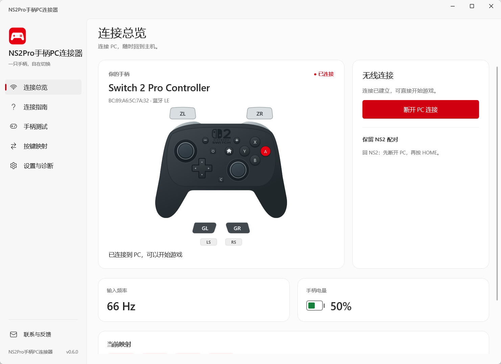

# NS2Pro手柄PC连接器

**近期更新**

- **v0.8**：新增可选 DualSense 触觉增强与组件自动管理，自动保持音频设备；完善连接取消、更换手柄、运行状态和诊断，提升使用体验与稳定性。
- **v0.7**：新增通用游戏震动、震动测试与强度调节，支持更新提醒和原位升级。
- **v0.6**：首次公开发布，支持无线连接、实时手柄测试与布局切换，并采用 MIT 开源协议。

小版本持续优化使用体验与稳定性，详细变更见[完整更新记录](CHANGELOG.md)。

通过蓝牙把 Nintendo Switch 2 Pro Controller 无线连接到 Windows，默认输出为 Xbox 360 / XInput 手柄，保留原有 NS2 配对。

[下载 v0.8.6 安装版（Windows x64）](https://github.com/ErenYaeger999/NS2ProCon/releases/download/v0.8.6/NS2Pro-0.8.6-win-x64-setup.exe) · [全部版本与附件](https://github.com/ErenYaeger999/NS2ProCon/releases)

<p align="center">
  
</p>
<p align="center"><sub>连接总览示意（截图为 v0.6.0，布局以当前版本为准）。</sub></p>

## 功能

- **无线连接**：使用顶部 SYNC 连接 PC；断开后可按 HOME 回到 NS2，无需重新配对。
- **实时测试**：矢量手柄按键高亮、双摇杆轨迹、轴数值、中心偏移和数字扳机状态。
- **两套映射**：首页直接选择 Nintendo 字母对应（A → A）或 Xbox 位置对应（A → B）；支持 0–30% 摇杆死区，修改即时生效。
- **电量与充电**：电池图标随电量变色，充电时显示闪电。
- **连接状态**：显示实际蓝牙回报率与本机转发耗时；转发耗时仅包含应用内处理和提交，不代表手柄到屏幕的总延迟。
- **游戏震动**：接收 Xbox 游戏的低／高频反馈，支持开关与强度调节；可测试低频、高频、左右侧、轻点和短脉冲，并立即停止。
- **托盘操作**：右键连接、取消等待、断开或退出；单实例运行，重复打开会恢复现有窗口。
- **更新提醒**：启动后检查最新正式版，有新版时提供 Release 下载入口，设置中也可手动检查。

当前支持按键、摇杆、电量、充电状态和通用游戏震动。HOME、截图、C、GL / GR 可检测，暂未映射到 Xbox；陀螺仪和耳机音频暂未支持。

## 系统要求与安装

- Intel / AMD **x64** 的 Windows 10 2004（19041）及以上，或 Windows 11。
- 支持 **蓝牙 LE 中央角色**的适配器，并开启蓝牙。
- 安装版自带 .NET、WinUI 运行环境和官方 **ViGEmBus 1.22.0** 离线安装器，无需另装 .NET、Python、WebView2 或启用开发者模式。

运行 `NS2Pro-版本-win-x64-setup.exe` 完成安装，再打开桌面或开始菜单入口。为所有用户安装以及安装缺少的官方驱动时需要管理员权限；已有 ViGEmBus 时跳过驱动安装，当前用户安装仅在缺少驱动时为驱动安装器提权。若提示重启，请重启后再连接。日常使用无需管理员权限。

下载新版安装包并退出应用后运行，安装器将沿用原安装位置、安装范围和快捷方式，保留个人设置。便携版未登记安装位置，需自行解压覆盖到原文件夹。更新检查在 GitHub API 限流或不可用时会尝试官方 Release 入口；无需登录，失败或离线时不影响使用。

应用只运行一个实例。旧版仍在后台时，打开另一份程序会返回旧窗口并提示退出；先从托盘选择「断开并退出」，再打开新版即可。已安装的增强组件会保留，新版会检测并复用兼容组件。

目前已在本机 Windows 11 x64 验证。Windows 10 干净系统首次安装、无驱动安装仍待实机验证；暂不支持 ARM64 和 32 位系统。发行者代码签名尚未配置。

## 使用方法

1. 拔掉手柄 USB 线，打开应用；首次进入按「连接指南」检查环境。
2. 点击「连接手柄」，再长按顶部充电口旁的 **SYNC** 小键，直到指示灯循环闪烁。无需在 Windows 蓝牙设置中手动配对；界面中的 ⓘ 可查看按键位置。
3. 状态显示已连接后，即可开始游戏，或进入「手柄测试」检查按键、摇杆和震动。
4. 回到 NS2 时，先点击「断开 PC 连接」，再按手柄 **HOME**。

**连接成功后，手柄指示灯持续闪烁属于正常现象。回到 NS2 时，先断开 PC 连接，再按 HOME。**

点窗口关闭按钮默认断开并退出；最小化可保持连接。需要关闭窗口后继续连接时，在设置中开启后台运行，再从托盘菜单完全退出。Windows 可能把托盘图标收在右下角「^」中。

「连接指南」位于侧栏底部「联系与反馈」上方。连接失败时点击「重试连接」；一直找不到手柄时，可在指南中检查 USB、其他连接工具，以及是否需要发现新手柄。不要让旧版控制台或其他桥接程序同时接管同一只手柄。

## 可选原生触觉增强

通过**虚拟 DualSense** 接收支持游戏的原生触觉，再适配为 NS2 Pro 震动。**具体游戏的震感是否提升尚无法确认，需实际体验后选择**；不保证优于通用模式，也不代表与 NS2 版本的 HD 震动相同。

默认通用兼容已包含普通游戏震动，可直接连接。想试用增强模式时，从「连接总览」右侧的「设置游戏模式」进入，选择「原生触觉增强（实验）」。应用先检测并复用已有组件，缺少时才显示安装入口；仅安装驱动时需要管理员权限和重启。以后由应用自动启动后端，无需另开控制台。若使用旧配置的手动后端，可点「改用自动管理并检测」；切换与重新检测不会自动安装组件。

高级选项中的「自动管理增强后端（推荐）」开启时由本应用管理；关闭时才手动连接其他软件已启动的后端，并显示端口设置。

选择增强后，设置页和连接总览会说明游戏可能显示 PS 按键图标，以及可在游戏中调整的方式；提示不会阻止连接。

组件按需下载，不计入默认安装包。环境未准备好不会阻断普通连接；已有增强在连接前检测失败时会回退通用兼容，游戏运行中不会自动更换虚拟设备。部分游戏需关闭该游戏的 Steam Input。

**自动保持音频设备**：增强连接和环境检测会记住原来的扬声器／耳机与麦克风；仅在本次虚拟 DualSense 成为默认设备时恢复原选择。你主动切换设备时保留新选择，不修改音量、静音或每应用音频路由。

若原设备已拔掉或游戏仍无声，可在 **Windows「设置 → 系统 → 声音」** 手动选择输出和输入设备，必要时重进游戏。

**增强模式的按键图标：游戏可能显示 PlayStation 提示。** 增强模式向游戏呈现的是 DualSense，游戏可能因此显示 △／○／×／□。本应用的 Nintendo／Xbox 布局预设只调整按键对应关系，不能控制游戏内的图标。

- 若游戏提供独立的「按键图标／提示样式」设置，可尝试选 Xbox／ABXY，同时保留本应用的增强模式；能否仅切换显示，取决于该游戏。
- 若游戏没有此选项，当前没有统一强制 Xbox 图标并保留原生触觉的办法。可先使用 PS 提示，或断开后切回「通用兼容」，使用 Xbox 输出和普通游戏震动。开启 Steam Input 转换也不能保证保留原生触觉，需按游戏验证。

**后续改进（TODO）**：

- 调研保留原生触觉时使用 Xbox 按键提示的逐游戏兼容方案；当前尚未实现，不能保证所有游戏适用。

本机已通过后端启动、真实虚拟 DualSense 与触觉音频端点自检；用户已在《空之轨迹2》中确认增强模式震动正常停止，并在 v0.8.4 确认连接后系统音频输入／输出、游戏声音和震动正常。不同游戏的触觉提升与更多设备的兼容性仍需分别验证。安装细节见[增强组件说明](docs/enhancement-setup.md)，实现范围和测试记录见[震动说明](docs/haptics.md)。

## 空间占用

v0.8.6 大小（MiB，取整）：

| 内容 | 大小 |
| --- | ---: |
| 安装包（EXE 下载） | **约 48 MiB** |
| 便携版（ZIP 下载） | 约 71 MiB |
| 完整发布目录，含运行环境、离线驱动和许可 | 约 177 MiB |

可选增强组件另行下载约 **35.5 MiB**。

## 开发

使用 C# / .NET 10 与原生 WinUI 3，依赖版本通过 NuGet 锁文件固定。需要 .NET SDK **10.0.402**；本地 SDK 可放在 `.tools/dotnet`，也可使用系统 SDK。

```powershell
./scripts/build.ps1                                      # 检查并编译
./scripts/build.ps1 -Publish -OutputDirectory artifacts/dev-new  # 发布到全新目录
./scripts/build-release.ps1 -OutputDirectory artifacts/release-new -SkipPackaging
# 上一条补齐离线驱动和许可、检查完整目录，但不生成安装包或 ZIP
./scripts/install-shortcut.ps1 -AppDirectory artifacts/release-new
```

发布完整安装包时运行 `scripts/build-release.ps1`。日常修改不逐次打包；变更记录见 [CHANGELOG](CHANGELOG.md)。发布检查报告记录文件哈希、运行环境自包含状态及完整目录大小。依赖调整后请使用全新输出目录，避免混入旧 DLL。

设置和日志保存在 `%LOCALAPPDATA%/NS2Pro`；SDK、下载包及构建产物不进入仓库。卸载应用会保留个人设置和共享 ViGEmBus 驱动。

回报率与转发计时、修复清单和验证边界见[本轮改进记录](docs/review-2026-10-18.md)。回归检查运行 `scripts/build.ps1`；交互式 Windows 桌面上的真实界面检查运行 `scripts/test-ui.ps1`。CI 自动执行核心检查并编译应用与界面测试，不安装驱动或连接实物手柄。正式打包前须提交已审阅的源码；`-SkipPackaging` 允许验证未提交的开发目录。

## 许可证

本项目原创代码采用 [MIT 许可证](LICENSE)，允许商业使用、修改和再分发，须保留版权和许可声明。

第三方组件和素材仍适用各自的许可；任天堂标志等第三方内容不在本项目的 MIT 授权范围内，相关版权与商标权归原权利人所有。来源见下方致谢，安装版和便携版均附带项目 `LICENSE.txt`，第三方许可保存在发布目录的 `Licenses` 文件夹。

## 来源与致谢

感谢以下作者和项目提供的协议研究、实现参考与基础组件：

| 作者 / 项目 | 本项目中的用途 |
| --- | --- |
| [ndeadly / switch2_controller_research](https://github.com/ndeadly/switch2_controller_research) | 广播、输入报告、校准读取及电源状态的协议资料 |
| [TommyWabg / Switch2Connect](https://github.com/TommyWabg/Switch2Connect) | 无线连接与 Xbox 桥接的实现参考 |
| [CareyScott / switch2controllerpc](https://github.com/CareyScott/switch2controllerpc) | 手柄连接与输入桥接的实现参考 |
| [Benjamin Höglinger-Stelzer / Nefarius：ViGEmBus](https://github.com/nefarius/ViGEmBus)、[ViGEmClient](https://github.com/nefarius/ViGEmClient) | 虚拟 Xbox 360 手柄驱动与客户端；ViGEmBus 使用官方 1.22.0 签名安装器 |
| [Yann Bouteiller / vgamepad](https://github.com/yannbouteiller/vgamepad) | 本项目随包的 ViGEmClient DLL 来自 vgamepad 0.1.0 发布文件，保留其许可 |
| [Microsoft / Windows App SDK](https://github.com/microsoft/WindowsAppSDK)、[.NET](https://github.com/dotnet/runtime) | 原生界面、Windows 接口与运行环境 |
| [David Desmet / NaCl.Core](https://github.com/daviddesmet/NaCl.Core) | MIT；Windows 10 的认证加密兼容实现，避免新增原生运行库或关闭认证。固定使用 2.2.0 |
| [SDL](https://github.com/libsdl-org/SDL)、[Jacques Gagnon / BlueRetro](https://github.com/darthcloud/BlueRetro) | 震动协议交叉核对及限幅策略参考；本项目自行实现 BLE 编码与调度 |
| [hbashton / VIIPER](https://github.com/hbashton/VIIPER) | 可选触觉增强后端，按需下载并独立运行，通过本机 VPCM V5 通信；保留包内许可证与来源，不链接其库 |
| [vadimgrn / usbip-win2](https://github.com/vadimgrn/usbip-win2) | 增强模式使用的官方签名 USBIP 驱动，按后端要求固定版本并按需下载 |

手柄示意图参考[任天堂官方正面图](https://www.nintendo.com/hk/hardware/switch2/accessories/assets/img/top/controller_switcher_img01.png)，Switch 2 标志参考 [Wikimedia 矢量资源](https://commons.wikimedia.org/wiki/File:Nintendo_Switch_2_logo_transparent_black.svg)；主题红色 `#E60012` 参考[任天堂官网样式](https://www.nintendo.com/jp/common/v3/css/shared.css)。应用图标为本项目原创，见 `src/NS2Pro.App/Assets/App.svg`。

随包第三方许可保存在 `Licenses`，仓库保留于 `third_party` 及依赖包中。本项目为独立工具，与任天堂、微软无隶属关系。

## 联系与反馈

应用左下角「联系与反馈」，或发送邮件至 **945558278@qq.com**。
